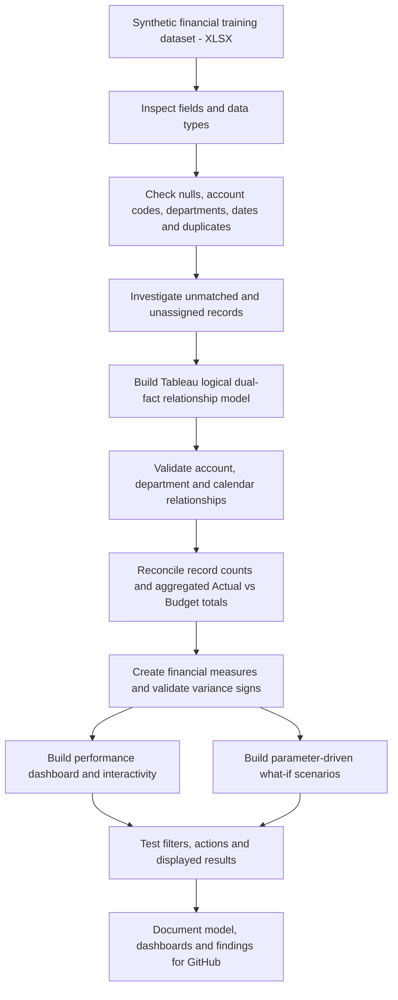
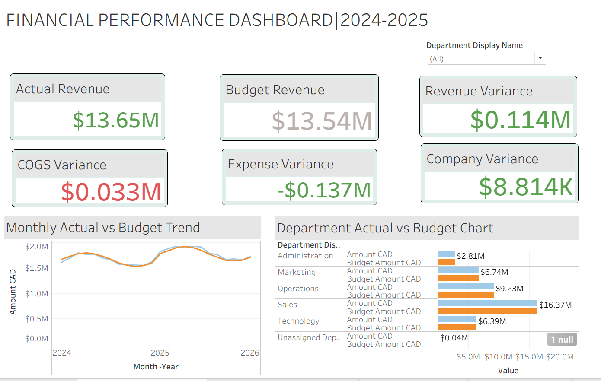
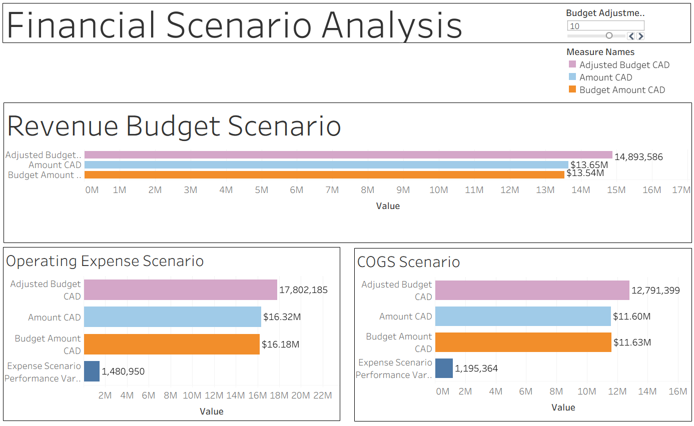
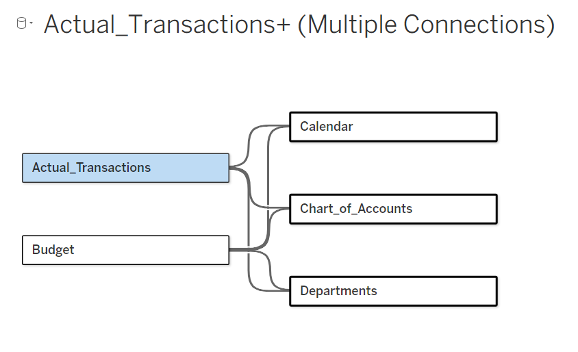
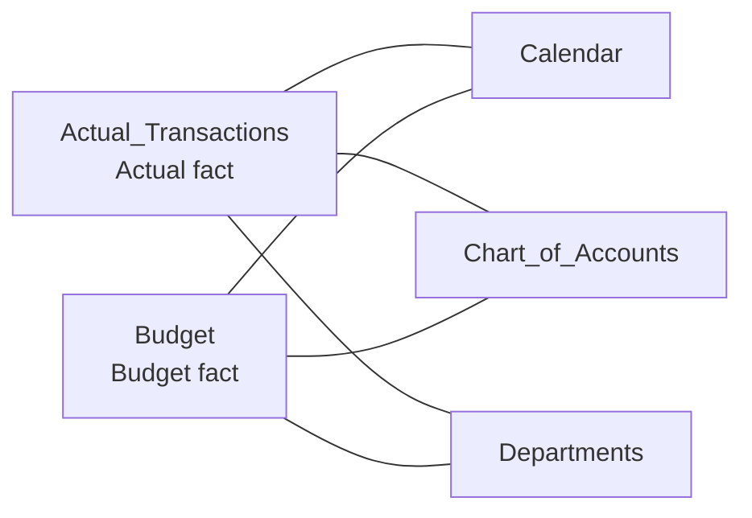

# Tableau Financial Performance & What-If Scenario Analysis

**End-to-end Business Intelligence portfolio project | Tableau Desktop | CAD**

An interactive financial reporting project built to compare actual results against budgets, validate a shared-dimension **dual-fact data model**, analyze department and monthly performance, and test hypothetical budget adjustments for Revenue, Operating Expense, and Cost of Goods Sold (COGS).

The work follows a structured approach: **data preparation and quality checks first, relationship/model validation second, financial calculations third, and dashboard development last.**

## Project workflow



## Dashboard previews

### Financial Performance Dashboard



Six financial KPI cards, monthly actual-versus-budget trends, departmental comparisons, and department-driven dashboard interactions.

### Financial Scenario Analysis Dashboard



Interactive Revenue, Operating Expense, and COGS scenarios, controlled by one **Budget Adjustment %** parameter. The parameter changes adjusted budgets without changing actuals or the original budgets.

## Data source and attribution

This project uses `financial-raw-data.xlsx`, a synthetic financial dataset originally used in the **Sales Financial Performance Analysis** Power BI portfolio project and subsequently reused for Tableau analysis.

The Excel workbook represents a fictional Canadian company and contains financial transaction records, departmental budgets, account classifications, and organizational information for January 2024 through December 2025.

The dataset includes 4,198 actual transactions and 1,200 budget records. It also intentionally contains data-quality issues for cleaning, investigation, and validation practice.

**Source attribution:** Synthetic portfolio training dataset, as documented in the workbook's `Data_Notes` worksheet. No external company financial data is represented.

The Tableau project additionally uses a Calendar table to support shared monthly reporting across the Actual and Budget fact tables.

## Data preparation, cleaning and quality validation

Data preparation and validation were carried out **before** the financial calculations and visualizations. Activities included:

1. **Source inspection:** Reviewed the Excel tables and inspected the types and contents of financial amount, account-code, department, and period fields.
2. **Missing-value checks:** Investigated missing account-code values and unassigned department records rather than silently dropping them from analysis.
3. **Data consistency:** Reviewed account classifications, financial categories (Revenue, COGS, Operating Expense), and monthly reporting dates to support like-for-like comparisons.
4. **Duplicate checks:** Examined potential duplicate transaction identifiers and possible impact on aggregation.
5. **Aggregation checks:** Compared record counts and Tableau summary values across categories, dates, and departments to help detect misclassification or unintended duplication.

**Observed issue:** A review of `Actual_Transactions` showed **4,198 rows** and identified **five records with missing Account Code values**. These were treated as a data-quality finding requiring attention when interpreting account-level results; this README does **not** claim the source records were corrected. An *Unassigned Department* category also appeared in departmental reporting.

**Scope note:** These checks are described as inspection/investigation activities; not every detected issue was necessarily remediated in the original source data. Users should verify their own source extracts before relying on the analysis for decisions.

## Data model architecture: dual-fact design

The updated Tableau data source is **`Actual_Transactions+ (Multiple Connections)`**. It contains **two fact tables** and **three shared dimensions** in Tableau's logical relationship layer.





| Table | Role | Purpose |
|---|---|---|
| `Actual_Transactions` | Fact | Actual recorded financial transactions and amounts |
| `Budget` | Fact | Planned financial amounts |
| `Calendar` | Shared dimension | Comparable monthly and reporting-period analysis |
| `Chart_of_Accounts` | Shared dimension | Account categories and Revenue/COGS/Operating Expense classifications |
| `Departments` | Shared dimension | Department grouping and filtering |

**Why this matters:** Actual transactions and budgets can have different levels of detail. Modeling them as separate facts linked to shared dimensions supports comparisons without directly joining each actual transaction to individual budget records, which could multiply amounts.

### Model validation before calculations

- Checked the **logical model structure** and that each fact relates to the Calendar, Chart of Accounts, and Departments dimensions.
- Reviewed account and department mappings, along with month/date alignment, for consistent comparisons.
- Used supporting worksheets (including *Multi Fact Model Validation*, *Calendar Relationship Validation*, and *Budget Scenario Validation*) to inspect whether model outputs and aggregations behaved as expected.
- Checked actual-versus-budget results by category, month, and department, including unmatched/unassigned cases.

**Verification boundary:** The model screenshot establishes the **existence of six logical relationships**, not their exact underlying field expressions, cardinality, or referential-integrity settings. Those should be inspected in Tableau's relationship dialogs before documenting specific key-to-key mappings.

## Business questions

- What is the variance between actual and budgeted revenue, operating expenses, and COGS?
- How do financial results evolve month by month?
- Which departments contribute most, and how do department actuals compare with budgets?
- How do alternative budget assumptions affect reported financial variances?
- What data-quality or modeling issues must be considered when interpreting results?

## Financial analysis and calculated fields

The Financial Performance Dashboard includes **six KPIs**: Actual Revenue, Budget Revenue, Revenue Variance, COGS Variance, Operating Expense Variance, and Company Performance Variance.

Financial variance signs are interpreted according to business meaning:

```text
Revenue variance = Actual Revenue - Budget Revenue
Expense performance variance = Budget Expense - Actual Expense
```

- **Revenue:** Actual above budget is favorable.
- **Costs:** Actual below budget is favorable.
- A positive/negative numeric difference should never be labeled favorable/unfavorable without checking the measure's convention and category.

The project also contains a **Monthly Actual vs Budget Trend**, a **Department Actual vs Budget Chart**, department filters, and interactive filter/highlight actions. Company-wide KPI cards were intentionally kept separate from the department-only exploration where applicable.

## Parameter-driven financial scenarios

A numeric **`Budget Adjustment %`** parameter drives scenario calculations:

```text
Adjusted Budget CAD = Budget Amount CAD * (1 + Budget Adjustment % / 100)
Revenue scenario variance = Actual Revenue - Adjusted Revenue Budget
Expense scenario performance variance = Adjusted Expense Budget - Actual Expense
```

The scenario dashboard contains three analyses:

| Scenario | Compared measures | Interpretation |
|---|---|---|
| Revenue | Actual, Original Budget, Adjusted Budget | Higher revenue targets reduce actual-minus-target variance if actuals stay fixed |
| Operating Expense | Actual, Original Budget, Adjusted Budget, Expense Performance Variance | A higher allowance increases budget-minus-actual variance |
| COGS | Actual, Original Budget, Adjusted Budget, Expense Performance Variance | Cost variance is favorable when actual spending is below the benchmark |

### Scenario test results

The parameter was tested at **0%, +5%, and +10%** for revenue, and at **0% and +10%** for Operating Expense and COGS.

| Metric | Baseline (0%) | +10% scenario |
|---|---:|---:|
| Original Revenue Budget | $13.54M | $13.54M |
| Adjusted Revenue Budget | $13.54M | $14.89M |
| Revenue Scenario Variance | +$113,734 | -$1,240,228 |
| Adjusted Operating Expense Budget | $16,183,804 | $17,802,185 |
| Operating Expense Performance Variance | -$137,431 | +$1,480,950 |
| Adjusted COGS Budget | $11,628,545 | $12,791,399 |
| COGS Performance Variance | +$32,510 | +$1,195,364 |

**Interpretation caveat:** Increasing an expense budget can make the *variance against that hypothetical budget* more favorable, but it does not reduce actual spending or improve profitability. Scenario amounts are illustrative analytical assumptions, not approved financial forecasts.

## Validation and testing before publication

- Verified original budgets remain constant while **Adjusted Budget** updates.
- Verified actual amounts do not change when the parameter changes.
- Cross-checked revenue, expense, and COGS scenario numbers between individual worksheets and the consolidated dashboard.
- Tested dashboard department selections, dropdown filters, monthly trend responses, and dynamic axis behavior.
- Inspected missing/unassigned records and the model relationship structure.

These are validation checks of the workbook's behavior, **not an independent financial audit**.

## Technology and skills demonstrated

**Tools:** Tableau Desktop; Microsoft Excel source data; GitHub for portfolio documentation.

**Skills:** Data profiling and quality investigation · Multi-fact dimensional modeling · Tableau logical relationships · Data/model validation · Financial calculations · Actual-versus-budget analysis · Aggregation checks · Dashboard design · Filter/highlight actions · Parameters · What-if analysis · Financial storytelling.

## Repository files

```text
Tableau-Financial-Performance-Analysis/
├── README.md
├── Tableau_Financial_Performance_Analysis.twbx
├── dual-fact-data-model.png
├── financial-performance-dashboard.png
└── financial-scenario-analysis.png
```

## Open and explore

1. Download [`Tableau_Financial_Performance_Analysis.twbx`](Tableau_Financial_Performance_Analysis.twbx).
2. Open it in a compatible Tableau Desktop installation (or a compatible Tableau viewer if supported).
3. Explore **Financial Performance Dashboard** to examine KPIs, department results, and monthly trends.
4. Open **Financial Scenario Analysis** and change **Budget Adjustment %** from 0 to 5 or 10 to compare scenarios.
5. Open the **Data Source** view for `Actual_Transactions+ (Multiple Connections)` to inspect the two-fact/three-dimension model.

> **Publication/privacy check:** Before pushing the `.twbx` to a public repository, inspect all embedded/linked datasets, metadata, and source paths; publish only information you have permission to share. A packaged workbook may contain underlying data, not just visualizations.

## Project takeaway

This project illustrates a full BI workflow: **prepare and inspect data → validate a shared-dimension dual-fact model → develop and check calculations → build interactive reporting → test parameter-driven budget scenarios → document findings for reproducible review**.
